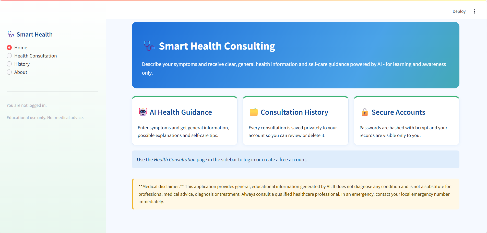
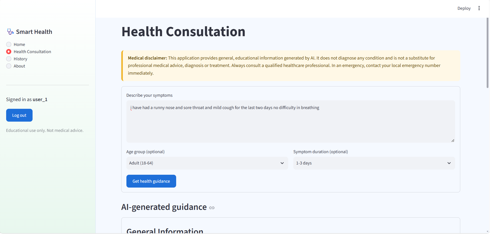
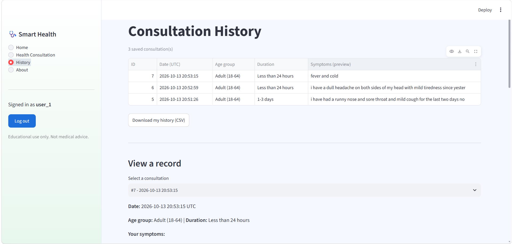

# 🩺 Smart Health Consulting

An AI-powered web application where users describe their symptoms and receive **general health information, possible explanations, self-care guidance, and advice on when to seek professional help**. Built with Python, Streamlit, the OpenAI API and SQLite.

> ⚠️ **Educational use only.** This app does not diagnose diseases and does not replace professional medical advice.

## Features

- Modern healthcare-themed UI (blue, white and light green) with Home, Health Consultation, History and About pages
- User registration, login, logout and session management
- Passwords hashed with **bcrypt**; input validation and duplicate-account handling
- AI consultation form (symptoms, optional age group and duration) using the OpenAI API
- Friendly handling of missing API key, invalid key, rate limits, timeouts and network failures
- Consultation history in SQLite: view, delete one, delete all, CSV export (Pandas)
- User-level access checks: every query is filtered by the logged-in user's ID
- Clear medical disclaimer throughout the app

## Technologies Used

Python · Streamlit · OpenAI API (or free Groq API) · SQLite · Pandas · bcrypt · python-dotenv

## Project Structure

```
Smart-Health-Consulting/
├── app.py                  # Streamlit UI and page navigation
├── auth.py                 # Validation, bcrypt hashing, login/register, sessions
├── database.py             # SQLite schema and parameterized queries
├── health_consultation.py  # OpenAI prompt and API error handling
├── requirements.txt
├── .env.example            # Placeholder settings (safe to commit)
├── .gitignore
├── README.md
├── test_app.py             # Automated tests (database + auth, no API calls)
├── .streamlit/config.toml  # Streamlit settings
└── assets/
    ├── style.css           # Custom theme
    └── screenshots/        # Put your screenshots here
```

## Installation (Windows PowerShell)

**1. Create and open the project folder** (or clone your repo)
```powershell
cd $HOME\Documents
git clone https://github.com/<your-username>/Smart-Health-Consulting.git
cd Smart-Health-Consulting
```

**2. Create a virtual environment** (an isolated Python for this project)
```powershell
python -m venv venv
```

**3. Activate it**
```powershell
.\venv\Scripts\Activate.ps1
```
If PowerShell blocks the script, run this once, then activate again:
```powershell
Set-ExecutionPolicy -Scope CurrentUser -ExecutionPolicy RemoteSigned
```

**4. Install dependencies**
```powershell
python -m pip install --upgrade pip
pip install -r requirements.txt
```

**5. Configure your AI key**

Create the settings file, then open it:
```powershell
Copy-Item .env.example .env
notepad .env
```

*Option A - OpenAI (needs paid API credit):* create a key at <https://platform.openai.com/api-keys> and set
```
LLM_PROVIDER=openai
OPENAI_API_KEY=your-real-key
```

*Option B - Groq (free tier):* create a key at <https://console.groq.com/keys> and set
```
LLM_PROVIDER=groq
GROQ_API_KEY=your-real-key
```

No quotes and no spaces before the lines. Save the file. Never share or commit `.env`; put real keys only in `.env`, never in `.env.example`.

**6. Run the app**
```powershell
streamlit run app.py
```
It opens at <http://localhost:8501>. If the page is blank, close old browser tabs and restart the app.

**7. Test it**
1. *Health Consultation* → **Register** tab → create an account (password: 8+ characters with a letter and a number).
2. **Login** with the same account.
3. Enter symptoms and click **Get health guidance**.
4. Open **History** → select a record → view it, then delete it.
5. Click **Log out** in the sidebar.

Optional automated tests (no API key needed):
```powershell
pip install pytest
python -m pytest -q
```

## Screenshots

| Home | Consultation | History |
|------|--------------|---------|
|  |  |  |

*(Add your own screenshots to `assets/screenshots/` after running the app.)*

## Security Notes

- API keys live in `.env`, which is git-ignored; only `.env.example` (placeholders) is committed.
- Passwords are salted and hashed with bcrypt; plain-text passwords are never stored.
- All SQL uses parameterized queries; consultation reads/deletes always include `user_id`.
- Login errors are generic and do not reveal whether a username exists.
- The SQLite database folder (`data/`) is git-ignored.
- This is a portfolio-grade design. A production system would add rate limiting on logins, HTTPS, email verification, encrypted storage and compliance review (e.g. HIPAA/GDPR) before handling real patient data.
- Symptom text is sent to OpenAI; do not enter personal identifiers.

## Medical Disclaimer

This application provides general, educational information generated by AI. It does not diagnose, treat or prevent any condition and is not a substitute for professional medical advice. Always consult a qualified healthcare professional. In an emergency, call your local emergency number immediately.

## Future Enhancements

- Password reset by email and login rate limiting
- Streaming AI responses
- Health-trend charts from consultation history
- Multi-language support
- Export a consultation as PDF
- Docker deployment and CI pipeline
